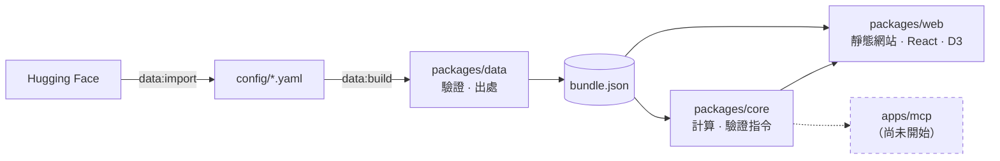

<div align="center">

# 🧮 inference-calculator

**國網推論算力計算機：這個推論工作負載，在國網每一種機台上要幾張卡？**

[](https://nchc-bio.github.io/inference-calculator/)


[](https://nchc-bio.github.io/inference-calculator/)

**[線上使用 →](https://nchc-bio.github.io/inference-calculator/)**

</div>

---

輸入模型、人數與任務類型，得到每個平台（H100、H200、GB200、Mac、DGX Spark）需要的 GPU 數、每人速度與首字時間。每個數字都附出處，並附上可在機台上執行的驗證指令。

> [!WARNING]
> H100／H200 以 SemiAnalysis InferenceX 的公開實測校正（每步固定開銷與首字開銷，Ruling R41），decode 大致在 ±25% 內，首字時間誤差仍大；GB200 沒有可用的公開實測，數字是外推的估算。全部尚待國網實測校正。

## 🧰 功能

| 函式 | 回答的問題 |
| --- | --- |
| **`estimateRequirements`** | 這個負載在每個平台各需要幾張卡？ |
| `estimateCapacity` | 這些卡最多能服務多少人？ |
| `estimatePerformance` | 我這幾張卡（含自訂硬體）在這個人數下每人多快？每種切法如何？ |
| `estimatePerformanceSweep` | 卡數從 1 加到 N，每人速度怎麼變、何時不再變快？ |
| `peakConcurrentFromTotal` | 只知道總人數時，尖峰同時大約幾人？ |
| `findFeasibleModels` | 這些卡能跑哪些模型？ |
| `explain` | 這個數字用了哪些數值、出處與公式？ |
| `verifyCommand` | 要怎麼在機台上驗證？ |

範例：200 人用 gpt-oss-120b 聊天、速度目標「流暢」（實際輸出摘錄）

| 平台 | GPU 數 | 每人速度 | 首字時間 |
| --- | --- | --- | --- |
| H200 nano4 | 1 | 27.0 tok/s | 0.11 s |
| H100 nano5 | 2 | 44.7 tok/s | 0.10 s |
| GB200 nano4 | 1 | 60.9 tok/s | 0.09 s |
| Mac Studio M5 Ultra | 12 台 | 21.6 tok/s | 0.17 s |
| Mac mini M5 Pro 64GB | ✗ 權重 65 GB，可用 48 GB | | |

## 🚀 快速開始

```bash
corepack enable
pnpm install
pnpm data:build    # 驗證 config/，輸出 packages/data/dist/bundle.json
pnpm test
pnpm calibrate     # 與公開實測的誤差報告
pnpm web:dev       # 本機開啟網站（Vite，http://localhost:5173）
pnpm web:e2e       # 以 Playwright 在桌面與手機尺寸跑真實瀏覽器測試
```

網站（[packages/web](packages/web/)，純靜態，`pnpm web:build` 輸出到 `packages/web/dist/`）已完成 v9：填空句輸入、一行答案、每個平台一列；沒有模式切換，在自己那一列調卡數就是反向查詢（我的卡能撐多少人、多快）。點開一列是試算區：打字示範、使用率與記憶體組成、切法、卡數與人數兩張速度曲線、建議動作與驗證指令。可新增自訂硬體、從 Hugging Face 匯入或手動輸入模型、自訂工作與速度；每一列可勾「比較」，比較卡片用摘要與疊線圖（人數→每人速度、人數→首字等待、GPU 張數→每人速度）並排最多 5 個方案，也能「換一項比較」（同機台換模型、精度、用途、讀入長度、數量或機台），比較會跟著句子即時更新並寫進網址；依據與引用是 Modal，準確度在頁尾。版面在 390／768／1024／1440 px 以真實瀏覽器驗證無橫向捲動，動畫以逐格截圖驗證。MCP 尚未開始。[docs/prototypes/](docs/prototypes/) 裡的是早期的靜態 UI 原型。

### 部署

- **CI**（[ci.yml](.github/workflows/ci.yml)）：每次 push 與 PR 跑 `typecheck` → `data:build` → `test` → `web:build` → `calibrate`。`web:e2e` 需要瀏覽器，只在本機跑。
- **CD**（[deploy.yml](.github/workflows/deploy.yml)）：push 到 `main` 時重跑 `typecheck` 與 `test`，再把 `packages/web/dist` 發布到 GitHub Pages：<https://nchc-bio.github.io/inference-calculator/>。第一次使用前，repo 管理員要在 Settings → Pages 把 Source 設為 GitHub Actions。
- 連結預覽（Open Graph／Twitter）、`robots.txt` 與 `sitemap.xml` 在 [packages/web/public/](packages/web/public/)；預覽圖 `og-image.png` 是真實網站畫面的截圖，也可以上傳到 repo 的 Settings → Social preview。

## 🗺️ 架構



YAML 是唯一的資料來源，程式碼不寫死任何硬體、模型或負載數值。

## 🛡️ 規則

由 `pnpm data:build` 強制執行，違反就建置失敗：

- **每個數值都要有出處**：標明 `official`／`measured`／`derived`／`estimate`，並附來源、公式或推估依據。

## 🎯 準確度

| 平台 | 狀態 |
| --- | --- |
| Mac Studio M5 Ultra | ⚠️ decode +0.5%（η_bw 由此點推得，屬循環驗證）；首字時間 +33.3%（超出 ±25%） |
| DGX Spark | ⬜ 沒有有效比對點 |
| H100 · H200 | ⚠️ InferenceX（vLLM v0.10.2–v0.22.0）36 個 validate 點：decode 18 點中 16 點在 ±25% 內（平均絕對誤差 15%；gpt-oss 8k 輸入 c=32／64 高估 +35%／+65%）；首字時間 18 點中 3 點（平均絕對誤差 54%，TP ≥ 2 的短 prompt 高估、長 prompt 與高併發低估）。fit 點 4 個（H200 TP=1 1k/1k c=4） |
| GB200 | ⬜ 沒有可用的公開實測（等待國網實測） |

## ⚙️ 設定

所有數值在 [config/](config/)：硬體、平台、量化、負載、校正、出處，以及由 HF 匯入的 [models/](config/models/)。新增模型：

```bash
pnpm data:import <owner/repo> --developer <名稱> --country <ISO2>
```

## 📖 文件

- [設計文件](docs/superpowers/specs/2026-10-19-inference-calculator-design.md)：計算模型、資料規則
- [網站 v8 設計](docs/superpowers/specs/2026-10-21-direct-manipulation-design.md)：版面、互動、動畫與實作時的決定（§11）
- 實作計畫：[core 與資料](docs/superpowers/plans/2026-10-19-core-and-config.md)、[網站主畫面](docs/superpowers/plans/2026-10-21-web-main-screen.md)、[core v8](docs/superpowers/plans/2026-10-21-core-v8.md)、[網站 v8](docs/superpowers/plans/2026-10-21-web-v8.md)
- [研究筆記](docs/research/)
